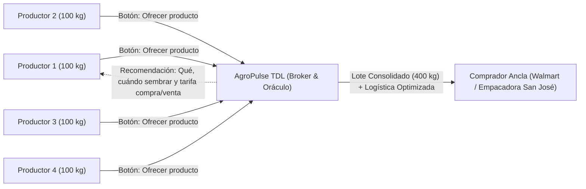

# AgroPulse TDL — Marketplace de Intermediación Inteligente y Oráculo Agrocomercial

**Proyecto Integrador: Trusted Data Lab (TDL) | Ingeniería en Sistemas Computacionales / Ciencia de Datos — Semestre 7**

**AgroPulse TDL** es una plataforma de **intermediación comercial inteligente (*Brokerage*) y oráculo agrícola** respaldada por un observatorio de datos auditado en **Colima** (*Tecomán, Armería y Manzanillo*). El sistema conecta y consolida la producción de pequeños y medianos agricultores de **Limón Mexicano, Papaya Maradol, Plátano Chiapas y Aguacate Hass** con compradores corporativos y empacadoras regionales, eliminando el coyotaje tradicional mediante ciencia de datos e ingeniería geoespacial.

---

## Modelo de Negocio: Marketplace de Intermediación Inteligente (*Brokerage*)

### 1. El Sistema como Intermediario Central (Cero Suscripciones)
* **Monetización por Margen de Intermediación (*Spread*):** **AgroPulse no cobra suscripciones ni membresías** a los agricultores. El negocio genera ingresos directamente del diferencial comercial en cada transacción ejecutada.
* **Consolidación Inteligente de Oferta (*Pool* de Productores):** Los pequeños productores individuales suelen quedar fuera de los contratos corporativos por no alcanzar el volumen mínimo requerido. AgroPulse agrupa automáticamente la oferta atomizada (por ejemplo, **4 agricultores aportando 100 kg cada uno**) para surtir un pedido mayorista único de un comprador ancla en Colima (por ejemplo, **Walmart** o **Empacadora San José solicitando 400 kg**).
* **Arbitraje Justo y Transparente:** El sistema compra en firme al productor a un **precio competitivo en origen** (superior al pago del coyote) y vende el lote consolidado al comprador corporativo a un **precio competitivo en destino**, reteniendo el diferencial neto tras optimizar el costo logístico.

### 2. Propuesta de Valor para el Productor (Flujo de Oferta y Oráculo Agrícola)
* **Botón Clave `"Ofrecer producto"`:** Interfaz directa donde el productor registra en segundos su cosecha disponible o proyectada (cultivo, kilogramos, ubicación de huerta y fecha de corte) para integrarse de inmediato a los bloques de venta activa.
* **Oráculo Agrícola Prescriptivo:** Más allá de comercializar la cosecha actual, AgroPulse opera como un asesor basado en datos que recomienda al productor **qué sembrar, cuándo sembrar y dónde vender**, cruzando cuatro vectores críticos:
  1. **Demanda local y regional proyectada** por comprador final.
  2. **Tiempo fenológico de cosecha** modulado por el clima en tiempo real (temperatura, lluvia y evapotranspiración en Colima).
  3. **Inversión requerida del productor** y costo de producción por kilogramo.
  4. **Costos de transporte y merma** hacia cada nodo de consumo.



---

## Justificación Técnica y Mapeo Curricular (Trusted Data Lab)

Cada componente matemático y de ingeniería del repositorio responde directamente a una decisión de dinero dentro del motor de *brokerage*:

| Materia TDL | Docente | Entrega / Módulo | Función en el Motor de Negocio de AgroPulse |
| :--- | :--- | :---: | :--- |
| **Análisis Estadístico para Ciencia de Datos** | Mtro. Joel | **Entrega E1** (`laboratorio/E1_pronosticos.ipynb`) | **Motor de Tarifas y Demanda (ARIMA / Holt-Winters):** Los modelos de series de tiempo sobre 48 meses predicen los **picos de demanda** y calculan el **"precio máximo" esperado** (con intervalos de confianza al 95%) para dictaminar algorítmicamente la tarifa óptima de compra al productor y de venta al comprador final. |
| **Ingeniería de Datos y Geoespacial** | Mtro. Román | **Entregas E0–E2** (`extractores/`, `pipeline/`) | **Cálculo Logístico por *Buckets* de Consumo:** El pipeline Medallion integra coordenadas de origen y calcula los **costos logísticos por distancia** entre las parcelas de los productores y el comprador final (*buckets* de consumo), optimizando la ruta de recolección y maximizando el margen neto del flete. |
| **Calidad en los Sistemas de Información** | Mtra. Isis | **Entregas E0–E4** (`calidad/`, `tests/`, `.github/workflows/`) | **Certificación Sello TDL (IEEE 730 e ISO 25010/25012):** Garantiza disponibilidad operativa $\ge 95\%$ ($\text{MTBF}/\text{MTTR}$), validación estricta con `pandera` ($0\%$ borrado silencioso hacia `data/cuarentena/`) y seguridad continua (`pytest`, `ruff`, `gitleaks`, `pip-audit`). |

---

## Equipo de Desarrollo

| Integrante | Rol Principal | Responsabilidades Clave | Gobernanza PSP / Calidad |
| :--- | :--- | :--- | :--- |
| **Carlos Daniel Tintos Beltrán** | *Data Engineer* | Extracción ética multifuente (`ExtractorEtico`), almacén Medallion (`bronce` $\rightarrow$ `plata` $\rightarrow$ `oro` + `cuarentena`), cálculo logístico, CI/CD y contratos `pandera`. | Bitácoras [`defectos-carlos.csv`](calidad/defectos-carlos.csv) y [`tiempo-carlos.csv`](calidad/tiempo-carlos.csv) (*Quality Lead* en E1 y E3) |
| **Oliver Vargas García** | *Data Statistician* | Modelos de Series de Tiempo ARIMA/Holt-Winters para fijación de tarifas (E1), Diseño Experimental Factorial $2^3/2^{4-1}$ (E2) y Análisis Multivariado PCA + MANOVA (E3). | Bitácoras [`defectos-oliver.csv`](calidad/defectos-oliver.csv) y [`tiempo-oliver.csv`](calidad/tiempo-oliver.csv) (*Quality Lead* en E0 y E2) |

---

## Arquitectura de la Solución (Medallion + Clean Code)

El sistema implementa una arquitectura modular desacoplada (funciones con responsabilidad única $\le 30$ líneas, tipado explícito, rutas centralizadas en [`config.py`](config.py) y cumplimiento estricto de **Cero Datos Personales** bajo la LFPDPPP):

```text
tdl-agropulse/
├── README.md                          # Visión ejecutiva del Marketplace, arquitectura y guía de uso
├── requirements.txt                   # Dependencias auditadas con pip-audit
├── config.py                          # Rutas Medallion, coordenadas agroproductoras y constantes
├── docs/
│   ├── plan-sqa.md                    # Plan de Aseguramiento de Calidad bajo norma IEEE 730 (E1)
│   ├── relatoria-E1.md                # Relatoría técnica E1 (evolución de datos, ARIMA/HW y MTBF/MTTR)
│   ├── E0/                            # ENTREGA.md y propuesta.md (Arranque)
│   └── E1/                            # ENTREGA.md (Puerta de calidad, pronósticos y CI/CD)
├── calidad/
│   ├── defectos-carlos.csv            # Registro PSP de defectos - Carlos Tintos
│   ├── defectos-oliver.csv            # Registro PSP de defectos - Oliver Vargas
│   ├── tiempo-carlos.csv              # Registro PSP de tiempos - Carlos Tintos
│   ├── tiempo-oliver.csv              # Registro PSP de tiempos - Oliver Vargas
│   └── bitacora_captura.csv           # Telemetría automática de ejecuciones (MTBF, MTTR y Disponibilidad)
├── extractores/
│   ├── base.py                        # Clase ExtractorEtico (robots.txt, pausa 1.5s, backoff) + bitácora
│   ├── extractor_api_clima.py         # Fuente 1: API Open-Meteo (48 meses + diario en Tecomán, Armería, Manzanillo)
│   ├── extractor_web_precios.py       # Fuente 2: Scraping ético SNIIM (48 meses, 768 registros + diario)
│   └── ejecutar_captura.py            # Orquestador de captura hacia Capa Bronce
├── pipeline/
│   ├── puerta_calidad.py              # Validación Pandera (Bronce -> Plata y Cuarentena sin borrado silencioso)
│   ├── limpieza.py                    # Diagnóstico MCAR/MAR, imputación, IQR, Min-Max y discretización
│   ├── integracion.py                 # Cruce relacional Precios + Clima + Costos logísticos hacia Capa Oro
│   └── orquestador_e1.py              # Ejecutor integral del pipeline Medallion E1
├── data/
│   ├── bronce/                        # Datos crudos con fecha_captura y fuente_origen (>= 48 periodos)
│   ├── plata/                         # Datos validados, limpios y normalizados
│   ├── oro/                           # dataset_analitico.csv y diccionario_datos.md (100% completitud)
│   └── cuarentena/                    # Registros rechazados con motivo_rechazo explícito
├── laboratorio/
│   └── E1_pronosticos.ipynb           # Modelos SES, Holt, Holt-Winters y ARIMA para fijación de tarifas
├── tablero/
│   └── app.py                         # Plataforma interactiva en Streamlit (Oráculo y pronósticos con IC 95%)
├── tests/
│   ├── test_extractores.py            # Pruebas unitarias de extracción y cardinalidad (>= 48 meses)
│   └── test_pipeline_e1.py            # Pruebas de puerta de calidad Pandera, cuarentena y Capa Oro
└── .github/
    └── workflows/
        ├── captura_diaria.yml         # Cron diario (08:00 UTC) de captura y procesamiento Medallion
        └── ci_cd.yml                  # Integración Continua (pytest + ruff + gitleaks + pip-audit)
```

---

## Instalación y Ejecución Reproducible

```bash
# 1. Instalar dependencias del proyecto
pip install -r requirements.txt

# 2. Ejecutar captura hacia Capa Bronce y Pipeline Medallion E1 (Plata, Cuarentena y Oro)
python -m extractores.ejecutar_captura
python -m pipeline.orquestador_e1

# 3. Validar estilo, pruebas unitarias y seguridad de dependencias
ruff check .
pytest tests/ -v
pip-audit --skip-editable

# 4. Iniciar la plataforma interactiva en Streamlit
streamlit run tablero/app.py
```

---

## Navegación de Entregables Oficiales

* **Entrega E0 (Arranque):** [Ficha E0 (`docs/E0/ENTREGA.md`)](docs/E0/ENTREGA.md) | [Propuesta del Observatorio y Modelo de Brokerage (`docs/E0/propuesta.md`)](docs/E0/propuesta.md)
* **Entrega E1 (Pipeline, Pronósticos y SQA):** [Ficha E1 (`docs/E1/ENTREGA.md`)](docs/E1/ENTREGA.md) | [Plan SQA IEEE 730 (`docs/plan-sqa.md`)](docs/plan-sqa.md) | [Relatoría E1 (`docs/relatoria-E1.md`)](docs/relatoria-E1.md) | [Notebook de Pronósticos (`laboratorio/E1_pronosticos.ipynb`)](laboratorio/E1_pronosticos.ipynb)
