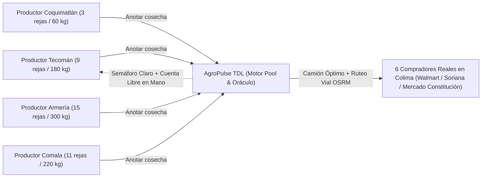

# AgroPulse TDL — Marketplace de Intermediación Inteligente y Oráculo Agrocomercial

**Proyecto Integrador: Trusted Data Lab (TDL) | Ingeniería en Sistemas Computacionales / Ciencia de Datos — Semestre 7**

**AgroPulse TDL** es una plataforma de **intermediación comercial inteligente (*Brokerage*) y oráculo agrícola** respaldada por un observatorio de datos 100% reales y auditados en **los 10 municipios del estado de Colima** (*Colima, Villa de Álvarez, Comala, Cuauhtémoc, Coquimatlán, Ixtlahuacán, Minatitlán, Tecomán, Armería y Manzanillo*). El sistema conecta y consolida la producción de pequeños y medianos agricultores de **Limón Mexicano, Papaya Maradol, Plátano Chiapas y Aguacate Hass** con comercios y mercados formales en Colima y las principales plazas nacionales, eliminando el coyotaje tradicional mediante ciencia de datos, ruteo carretero real y lenguaje claro para el productor.

---

## Modelo de Negocio: Marketplace de Intermediación Inteligente (*Brokerage*)

### 1. El Sistema como Intermediario Central (Cero Suscripciones)
* **Monetización por Margen de Intermediación (*Spread*):** **AgroPulse no cobra suscripciones ni membresías** a los agricultores. El negocio genera ingresos exclusivamente por comisión de intermediación (`8.5%`) sobre cada lote consolidado y liquidado con éxito.
* **Consolidación Inteligente de Kilaje Libre (*Pool* Multi-Productor):** Los pequeños agricultores individuales quedan fuera de los contratos formales por ofrecer volúmenes heterogéneos (*60 kg, 180 kg, 300 kg* o su equivalente en **rejas de 20 kg**). AgroPulse consolida aportes libres de múltiples productores de Colima, asigna automáticamente el transporte óptimo (*Pickup $\le 850\text{ kg}$, Camión Rabón $3.5\text{ Ton}$ o Torton Refrigerado*) y surte pedidos directos de **6 compradores reales verificados en OpenStreetMap** (*Mercado Constitución Colima, Walmart Colima, Soriana Híper Villa de Álvarez, Bodega Aurrera Tecomán, Mi Bodega Aurrera Armería y Soriana Híper Manzanillo*).
* **Liquidación Transparente vs. Coyote:** El sistema descuenta de forma visible el flete carretero real y la merma térmica, garantizando un pago libre en mano muy superior al del intermediario informal (*coyote*).

### 2. Propuesta de Valor para el Productor (Lenguaje Claro y Oráculo Agrícola)
* **Vista en Lenguaje Claro para el Productor (`tablero/vistas_productor.py`):** Interfaz pensada para el campo sin tecnicismos estadísticos: captura en **rejas de 20 kg o kilos sueltos**, tarjetas en pesos libres en mano, desglose peso por peso y botón directo para anotar cosecha en el camión compartido.
* **Oráculo Agrícola Prescriptivo:** Semáforo de recomendación en palabras sencillas (*¿cortar y vender hoy o esperar mejor precio?*) cruzando cuatro fuentes abiertas auditadas:
  1. **Cotizaciones reales diarias y serie de 48 meses del SNIIM** en **5 plazas oficiales** (*Colima, Guadalajara, Morelia, CDMX-Iztapalapa y Monterrey* — `960` registros analíticos sin truncamiento).
  2. **Clima satelital ERA5 y pronóstico diario (`Open-Meteo`)** en los **10 municipios de Colima** para estimar merma térmica en tránsito.
  3. **Ruteo carretero real (`OSRM` + `GeoPandas EPSG:32613` UTM 13N)** sobre las **60 rutas estatales** (`10 municipios × 6 compradores`).
  4. **Pronósticos estadísticos con intervalos de confianza al 95%** (SES, Holt, Holt-Winters y ARIMA/SARIMA).



---

## Justificación Técnica y Mapeo Curricular (Trusted Data Lab)

| Materia TDL | Docente | Entregas / Módulos | Función en el Motor de Negocio de AgroPulse |
| :--- | :--- | :---: | :--- |
| **Análisis Estadístico para Ciencia de Datos** | Mtro. Joel | **E1–E3** (`laboratorio/`) | **Pronósticos ARIMA/Holt-Winters (E1)** para anticipar precios en 5 plazas, **Diseño Factorial $2^3 / 2^{4-1}$ (E2)** sobre variables logísticas y **PCA + MANOVA (E3)** para segmentar rentabilidad agroclimática. |
| **Ingeniería de Datos y Geoespacial** | Mtro. Román | **E0–E3** (`extractores/`, `pipeline/`) | Extracción ética anualizada sin truncamiento (`ExtractorEtico`), almacén Medallion vectorizado, **60 rutas carreteras reales OSRM + UTM 13N**, benchmark medido (`+27%` velocidad, `-83%` disco Parquet) y dataset abierto `CC BY 4.0`. |
| **Calidad en los Sistemas de Información** | Mtra. Isis | **E0–E4** (`calidad/`, `tests/`, `.github/workflows/`) | **Certificación Sello TDL (IEEE 730 e ISO 25010/25012):** disponibilidad $\ge 99\%$, validación `pandera` ($0\%$ borrado silencioso), linaje `SHA-256` en formato `LF` y suite continua (`15/15 pytest`, `ruff`, `gitleaks`, `pip-audit`). |

---

## Equipo de Desarrollo

| Integrante | Rol Principal | Responsabilidades Clave | Gobernanza PSP / Calidad |
| :--- | :--- | :--- | :--- |
| **Carlos Daniel Tintos Beltrán** | *Data Engineer* | Extracción ética multifuente (`ExtractorEtico`), almacén Medallion (`bronce` $\rightarrow$ `plata` $\rightarrow$ `oro` $\rightarrow$ `publicado`), ruteo OSRM/GeoPandas, motor de *brokerage*, CI/CD y contratos `pandera`. | Bitácoras [`defectos-carlos.csv`](calidad/defectos-carlos.csv) y [`tiempo-carlos.csv`](calidad/tiempo-carlos.csv) (*Quality Lead* en E1 y E3) |
| **Oliver Vargas García** | *Data Statistician* | Modelos de Series de Tiempo ARIMA/Holt-Winters (E1), Diseño Experimental Factorial $2^3/2^{4-1}$ (E2) y Análisis Multivariado PCA + MANOVA (E3). | Bitácoras [`defectos-oliver.csv`](calidad/defectos-oliver.csv) y [`tiempo-oliver.csv`](calidad/tiempo-oliver.csv) (*Quality Lead* en E0 y E2) |

---

## Arquitectura de la Solución (Medallion + Clean Code)

```text
tdl-agropulse/
├── README.md                          # Visión ejecutiva, arquitectura estatal de 10 municipios y guía de uso
├── requirements.txt                   # Dependencias auditadas con pip-audit (0 CVEs)
├── config.py                          # Rutas Medallion, 10 municipios, 5 plazas SNIIM, 6 compradores OSM y flota
├── docs/
│   ├── plan-sqa.md                    # Plan de Aseguramiento de Calidad bajo norma IEEE 730 (E1)
│   ├── etica-datos.md                 # Declaración ética, legal y cumplimiento de robots.txt (E2)
│   ├── auditoria/                     # Auditorías formales ISO/IEC 25010 y 25012 (E2 y E3)
│   ├── E0/ E1/ E2/ E3/                # Fichas oficiales de entrega y Datasheet Gebru et al. (E3)
│   └── relatoria-E1..E3.md            # Relatorías técnicas evolutivas del observatorio
├── calidad/
│   ├── defectos-carlos.csv / oliver   # Registros PSP individuales de defectos
│   ├── tiempo-carlos.csv / oliver     # Registros PSP individuales de tiempos
│   ├── benchmark_e3.csv               # Evidencia cuantitativa Antes vs. Después (E3)
│   └── bitacora_captura.csv           # Telemetría automática de ejecuciones (MTBF, MTTR y Disponibilidad)
├── extractores/
│   ├── base.py                        # Clase ExtractorEtico (robots.txt, pausa, backoff y SHA-256 LF)
│   ├── extractor_api_clima.py         # Fuente 1: API Open-Meteo ERA5 + Forecast en los 10 municipios de Colima
│   ├── extractor_web_precios.py       # Fuente 2: Portal SNIIM anualizado sin truncar (5 plazas con Colima, 960 filas)
│   ├── extractor_geoespacial.py       # Fuente 3: Nodos municipales y comercios reales de Colima en OpenStreetMap
│   └── ejecutar_captura.py            # Orquestador integral de captura hacia Capa Bronce
├── pipeline/
│   ├── puerta_calidad.py              # Contratos Pandera cacheados (Bronce -> Plata y Cuarentena)
│   ├── limpieza.py                    # Limpieza estadística vectorizada en NumPy (MCAR/MAR, IQR, Min-Max)
│   ├── geoespacial.py                 # Ruteo carretero real OSRM + GeoPandas EPSG:32613 (60 rutas estatales)
│   ├── motor_brokerage.py             # Liquidador B2B multi-productor de kilaje libre, flota y merma térmica
│   ├── integracion.py                 # Cruce relacional, linaje SHA-256, Parquet y diccionario de datos
│   ├── publicacion.py                 # Paquete abierto curado bajo licencia CC BY 4.0 en data/publicado/
│   ├── benchmark_e3.py                # Medición reproducible con perf_counter y tracemalloc
│   └── orquestador_e1.py              # Ejecutor en memoria de punta a punta (Bronce -> Publicado)
├── data/
│   ├── bronce/ plata/ oro/ cuarentena/# Capas Medallion trazables mediante fichas .meta.json SHA-256
│   └── publicado/                     # Dataset abierto agropulse_colima_curado (.csv LF + .parquet + LICENSE)
├── laboratorio/
│   ├── E1_pronosticos.ipynb           # Modelos SES, Holt, Holt-Winters y ARIMA
│   ├── E2_diseno_experimentos.ipynb   # Diseño experimental factorial 2^3 y fraccionado 2^(4-1)
│   └── E3_multivariado_pca_manova.ipynb # Análisis de Componentes Principales (PCA) y MANOVA bifactorial
├── tablero/
│   ├── vistas_productor.py            # Vista en lenguaje claro (rejas de 20 kg, cuentas libres y semáforo)
│   └── app.py                         # Portal interactivo en Streamlit (Modo Productor + Modo Jurado Técnico)
├── tests/                             # 15 pruebas automatizadas E0-E3 + auditoría contra truncamiento y PII
└── .github/workflows/                 # Cron diario (08:00 UTC con data/publicado/) y CI/CD de seguridad
```

---

## Instalación y Ejecución Reproducible

```bash
# 1. Instalar dependencias del proyecto
pip install -r requirements.txt

# 2. Ejecutar captura multifuente y Pipeline Medallion completo (Bronce -> Plata -> Oro -> Publicado)
python -m extractores.ejecutar_captura
python -m pipeline.orquestador_e1

# 3. Validar estilo, las 15 pruebas unitarias y seguridad de dependencias
ruff check .
pytest tests/ -v
pip-audit --skip-editable --progress-spinner off

# 4. Iniciar la plataforma interactiva en Streamlit (Vista Productor + Vista Técnica)
streamlit run tablero/app.py
```

---

## Navegación de Entregables Oficiales

* **Entrega E0 (Arranque):** [Ficha E0 (`docs/E0/ENTREGA.md`)](docs/E0/ENTREGA.md) | [Propuesta del Observatorio (`docs/E0/propuesta.md`)](docs/E0/propuesta.md)
* **Entrega E1 (Pipeline, Pronósticos y SQA):** [Ficha E1 (`docs/E1/ENTREGA.md`)](docs/E1/ENTREGA.md) | [Plan SQA IEEE 730 (`docs/plan-sqa.md`)](docs/plan-sqa.md) | [Relatoría E1 (`docs/relatoria-E1.md`)](docs/relatoria-E1.md) | [Notebook E1 (`laboratorio/E1_pronosticos.ipynb`)](laboratorio/E1_pronosticos.ipynb)
* **Entrega E2 (Geoespacial, DoE e ISO):** [Ficha E2 (`docs/E2/ENTREGA.md`)](docs/E2/ENTREGA.md) | [Ética de Datos (`docs/etica-datos.md`)](docs/etica-datos.md) | [Auditoría ISO E2 (`docs/auditoria/auditoria-iso-E2.md`)](docs/auditoria/auditoria-iso-E2.md) | [Notebook E2 (`laboratorio/E2_diseno_experimentos.ipynb`)](laboratorio/E2_diseno_experimentos.ipynb)
* **Entrega E3 (Optimización, Datos Abiertos y Multivariado):** [Ficha E3 (`docs/E3/ENTREGA.md`)](docs/E3/ENTREGA.md) | [Datasheet (`docs/E3/datasheet.md`)](docs/E3/datasheet.md) | [Auditoría ISO E3 (`docs/auditoria/auditoria-iso-E3.md`)](docs/auditoria/auditoria-iso-E3.md) | [Notebook E3 (`laboratorio/E3_multivariado_pca_manova.ipynb`)](laboratorio/E3_multivariado_pca_manova.ipynb)
